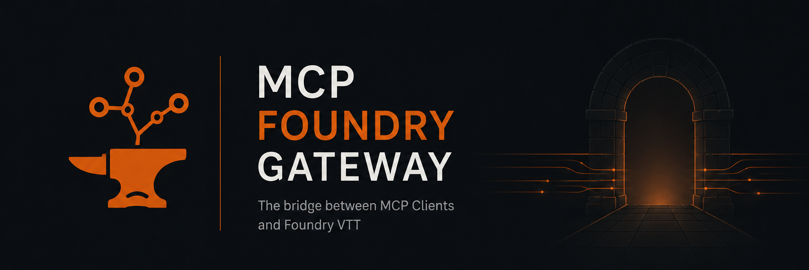
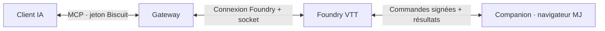

# MCP Gateway pour Foundry VTT

**Préparez votre prochaine partie avec une IA capable de travailler dans votre monde Foundry.**

Retrouvez votre lore, créez des PNJ et des journaux, organisez vos quêtes et animez votre table.
MCP Gateway relie Claude ou un autre client IA compatible à Foundry VTT grâce à
[MCP](https://modelcontextprotocol.io), le protocole qui permet à un assistant d'utiliser des outils externes.

[English](README.md) · [Commencer](docs/installation.fr.md) · [Toutes les capacités](docs/capabilities.fr.md) · [Discussions](https://github.com/wanoo/foundry-mcp-gateway/discussions)

## De l'idée à la partie préparée

Votre campagne est déjà dans Foundry. Votre assistant peut consulter ses vrais
journaux, acteurs, scènes et compendiums, puis enregistrer votre préparation
là où vous en avez besoin. Par exemple :

> « Lis nos notes de séance et crée un journal MJ avec les pistes ouvertes et trois accroches pour la prochaine partie. »

> « Retrouve l'aubergiste et les lieux qui lui sont liés. Propose deux rumeurs et ajoute-les dans un nouveau journal. »

> « Examine nos quêtes actives, propose les objectifs de la prochaine séance et attends mon accord avant de les modifier. »

Les outils de documents fonctionnent avec tous les systèmes de jeu. Des outils
de dés et de personnages dédiés prennent en charge **Star Wars FFG, D&D 5e et
Daggerheart**. Des intégrations facultatives relient aussi fiches de campagne,
calendriers, ressources et ambiances à ce travail de préparation.

Pendant la partie, votre assistant peut révéler une illustration, emmener le
groupe sur une scène, lancer des dés, poser une question à un joueur ou déclencher
des sons et des effets. Les actions navigateur passent par le Companion ; certains
effets nécessitent leurs modules Foundry. Consultez les
[capacités et dépendances](docs/capabilities.fr.md).

## Une application, deux composants

| Composant | Où il fonctionne | Son rôle |
|---|---|---|
| **Gateway** — ce dépôt | Une machine qui peut joindre Foundry ; Docker ou binaire Rust | Le point d'accès MCP, la connexion Foundry, les outils de documents et les intégrations |
| **[Companion](https://github.com/wanoo/foundry-mcp-gateway-companion)** | Un module de votre monde Foundry, exécuté dans le navigateur MJ | Valeurs des fiches, captures de scène, jets natifs, dialogues joueurs et API du navigateur |

**Installez les deux pour profiter de l'ensemble.** Le Gateway peut aussi préparer
des documents seul, sans navigateur MJ ouvert. Les outils Companion nécessitent
un navigateur MJ connecté avec un onglet actif ; la connexion du bot ne le
remplace pas. Le client IA et l'installation Foundry sont des prérequis séparés.

## Se connecter

Le **[guide d'installation](docs/installation.fr.md)** propose un parcours Docker
complet avec les commandes à reprendre. Aucun environnement Rust n'est nécessaire.

1. Lancez votre monde Foundry et créez un utilisateur bot dédié.
2. Générez une clé racine MCP, un jeton client et une clé de signature Companion stable.
3. Démarrez le Gateway avec l'image Docker publiée et vos identifiants Foundry.
4. Ajoutez son URL `/mcp-<token>` aux connexions Streamable HTTP de votre client IA.
5. Installez et activez le Companion, appelez `companion_trust_key`, puis rechargez les navigateurs MJ.
6. Demandez à votre assistant d'appeler `ping` et `client_status`.

Le Gateway prend en charge Foundry v13 et v14. Le Companion déclare un minimum
v12 et une version vérifiée v14 ; la paire 1.7 a été testée sur **Foundry 14.369**.
Cela ne signifie pas que l'application complète a été testée sur chaque build
Foundry ou chaque système de jeu.

## Qu'apporte la 1.8 ?

Gateway et Companion sont livrés ensemble : installez la même version
**majeure.mineure** des deux.

- **La 1.6 a établi les contrôles d'accès :** jetons clients Biscuit et commandes
  Companion authentifiées remplacent le fonctionnement à secret partagé.
- **La 1.7 enrichit la préparation de campagne :** quêtes, objectifs, visibilité
  et boutiques Campaign Codex 6.9 ; dates et météo Mini Calendar 10 ; recherche
  Asset Librarian 1.4 ; comptes à rebours, éclairage et ambiances Mini Player.
- **La 1.7 corrige aussi des parcours Foundry 14**, notamment la création de scènes,
  le ciblage, les mises à jour des documents en direct et les routes d'administration.
- **La 1.8 prépare scènes et butin :** pièges et interrupteurs Monk's Active Tiles
  écrits côté serveur, coffres, tas et marchands Item Piles, presets Mass Edit
  posés ou enregistrés sur une scène.
- **La 1.8 ferme les chemins de code cachés dans les données :** tuiles, scripts
  de région, scripts de presets et macros de piles suivent les réglages de script
  du Companion, que la Gateway ne peut plus modifier.

Le catalogue 1.8 propose **184 outils** : 176 sans mot de passe administrateur,
plus 8 outils d'administration. Il comprend 76 outils de lecture seule et
56 outils compagnon. Votre jeton et votre configuration déterminent les outils
accessibles à votre client. Consultez le [catalogue](docs/capabilities.fr.md)
ou le [changelog](CHANGELOG.md), en anglais.

Vous mettez à jour ? Le [guide avancé](docs/advanced.fr.md#mises-à-jour) sépare la
migration depuis la 1.5 de la mise à jour 1.6 → 1.7. Gardez les deux composants
sur le même **majeur.mineur**, par exemple 1.7.x ; les correctifs peuvent différer.

## Accès et confiance

**Les jetons Biscuit contrôlent l'accès du client IA au Gateway.** Chaque jeton
expire, peut être limité à la lecture seule et peut être révoqué individuellement.
L'URL de connexion complète est un identifiant confidentiel : gardez-la privée et
utilisez HTTPS si vous exposez le Gateway au-delà de votre machine.

**Les signatures ECDSA P-256 authentifient les commandes du Gateway auprès du
Companion.** Elles utilisent une clé stable distincte et une clé publique
installée dans le monde. Elles ne chiffrent pas les réponses socket. Le JavaScript
distant est désactivé par défaut ; les macros de script distantes demandent
l'accord du MJ. Vos prompts ne remplacent pas ces réglages du module.
Consultez la [configuration des accès](docs/advanced.fr.md#accès-et-confiance-du-companion).

## Explorer et participer

- [Installation](docs/installation.fr.md) — Docker, clés, première connexion et Companion.
- [Capacités et intégrations](docs/capabilities.fr.md) — outils regroupés par usages et dépendances.
- [Configuration avancée et dépannage](docs/advanced.fr.md) — installation native, Compose, hébergement, accès et plusieurs mondes.
- [Contrat d'intégration](docs/integrators.md), en anglais — formats de réponse pour les applications utilisant MCP directement.
- [GitHub Discussions](https://github.com/wanoo/foundry-mcp-gateway/discussions) — partagez votre préparation, proposez une intégration ou demandez de l'aide.
- [Signaler un bug Gateway](https://github.com/wanoo/foundry-mcp-gateway/issues) · [Signaler un bug Companion](https://github.com/wanoo/foundry-mcp-gateway-companion/issues).
- [Contribuer](CONTRIBUTING.md) · [Changelog](CHANGELOG.md) · [Politique de sécurité](SECURITY.md), en anglais.

[Licence MIT](LICENSE). Projet indépendant, sans affiliation avec Foundry Gaming LLC.
