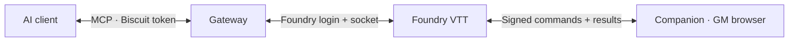

# MCP Gateway for Foundry VTT

**Prepare your next session with an AI that can work inside your Foundry world.**

Find campaign lore, create NPCs and journals, organize quests, and bring your table to life.
MCP Gateway connects Claude or another compatible AI client to Foundry VTT through
[MCP](https://modelcontextprotocol.io), the protocol that lets an assistant use external tools.

[Français](README.fr.md) · [Get started](docs/installation.md) · [All capabilities](docs/capabilities.md) · [Discussions](https://github.com/wanoo/foundry-mcp-gateway/discussions)

## From an idea to a prepared session

Your campaign already lives in Foundry. Let your assistant work with its actual
journals, actors, scenes and compendia, then save the preparation where you use it.
For example:

> “Read our session notes and create a GM journal with unresolved leads and three hooks for next time.”

> “Find the innkeeper and their linked locations. Draft two rumors and add them to a new journal.”

> “Review our active quests, propose next-session objectives, and wait for my approval before updating them.”

The core document tools work across game systems. Dedicated dice and character
helpers support **Star Wars FFG, D&D 5e and Daggerheart**. Optional integrations
connect campaign sheets, calendars, assets and ambience to the same workflow.

During a session, your assistant can also reveal a handout, move the party to a
scene, roll dice, ask a player a question, or cue sound and visual effects.
Browser actions use the Companion; some effects also need their Foundry modules.
See the [capabilities and dependencies](docs/capabilities.md).

## One application, two components

| Component | Where it runs | What it contributes |
|---|---|---|
| **Gateway** — this repository | A machine that can reach Foundry; Docker or a Rust binary | The MCP endpoint, Foundry connection, document tools and integrations |
| **[Companion](https://github.com/wanoo/foundry-mcp-gateway-companion)** | A module in your Foundry world, running in the GM's browser | Live sheet values, scene captures, native rolls, player dialogs and browser APIs |

**Install both for the full experience.** The Gateway can also prepare documents
on its own, without a GM browser open. Companion tools need a connected GM
browser with an awake tab; the Gateway's bot connection does not replace it.
Your AI client and Foundry installation are separate prerequisites.

## Get connected

Follow the **[installation guide](docs/installation.md)** for a complete Docker
setup with copyable commands. No Rust toolchain is needed.

1. Launch your Foundry world and create a dedicated bot user.
2. Generate an MCP root key, a client token and a stable Companion signing key.
3. Start the Gateway using the published Docker image and your Foundry credentials.
4. Add its `/mcp-<token>` URL to your AI client's Streamable HTTP connections.
5. Install and enable the Companion, run `companion_trust_key`, and reload GM browsers.
6. Ask your assistant to run `ping` and `client_status`.

Foundry v13 and v14 are supported by the Gateway. The Companion declares a
minimum of v12 and is verified for v14; the paired 1.7 release was tested on
**Foundry 14.369**. This does not claim that the complete application was tested
on every Foundry build or every game system.

## What changes in 1.8?

Gateway and Companion ship together: install the same **major.minor** of both.

- **1.6 established access controls:** Biscuit client tokens and authenticated
  Companion commands replace the earlier shared-secret workflow.
- **1.7 expands campaign preparation:** Campaign Codex 6.9 quests, objectives,
  visibility and shops; Mini Calendar 10 dates and weather; Asset Librarian 1.4
  search; countdowns, lighting and Mini Player ambience.
- **1.7 also fixes Foundry 14 workflows**, including scene creation, targeting,
  live document updates and administration routes.
- **1.8 prepares scenes and loot:** Monk's Active Tiles traps and switches
  written from the server, Item Piles chests, piles and merchants, Mass Edit
  presets placed or saved on a scene.
- **1.8 closes code paths hidden in data:** tiles, region scripts, preset
  scripts and pile macros obey the Companion's script settings, which the
  Gateway can no longer change.

The 1.8 catalogue has **184 tools**: 176 without an admin password, plus 8
administration tools. It includes 76 read-only tools and 56 companion tools.
Your token and configuration determine which tools your client can use.
Browse the [full catalogue](docs/capabilities.md) or the [changelog](CHANGELOG.md).

Upgrading? The [advanced guide](docs/advanced.md#upgrading) separates the
1.5 migration from the 1.6 → 1.7 update. Keep both components on the same
**major.minor**, for example 1.7.x; patch numbers may differ.

## Access and trust

**Biscuit tokens control access from your AI client to the Gateway.** Each token
expires, can be restricted to read-only access, and can be revoked individually.
The full connection URL is a credential: keep it private and use HTTPS when
exposing the Gateway beyond your machine.

**ECDSA P-256 signatures authenticate Gateway commands to the Companion.** This
uses a separate, stable key and a public key installed in your world. It does
not encrypt socket replies. Remote JavaScript is off by default; remote script
macros ask the GM first. Your prompts do not replace these module settings.
See [configuration and trust](docs/advanced.md#access-and-companion-trust).

## Explore and join in

- [Installation](docs/installation.md) — Docker, keys, first connection and Companion setup.
- [Capabilities and integrations](docs/capabilities.md) — tools grouped by GM workflow and their dependencies.
- [Advanced configuration and troubleshooting](docs/advanced.md) — native installs, Compose, hosting, access controls and multiple worlds.
- [Integrator contract](docs/integrators.md) — response shapes for applications calling MCP directly.
- [GitHub Discussions](https://github.com/wanoo/foundry-mcp-gateway/discussions) — share a preparation workflow, suggest an integration or ask for help.
- [Report a Gateway bug](https://github.com/wanoo/foundry-mcp-gateway/issues) · [Report a Companion bug](https://github.com/wanoo/foundry-mcp-gateway-companion/issues).
- [Contribute](CONTRIBUTING.md) · [Changelog](CHANGELOG.md) · [Security policy](SECURITY.md).

[MIT licensed](LICENSE). Independent project, not affiliated with Foundry Gaming LLC.
